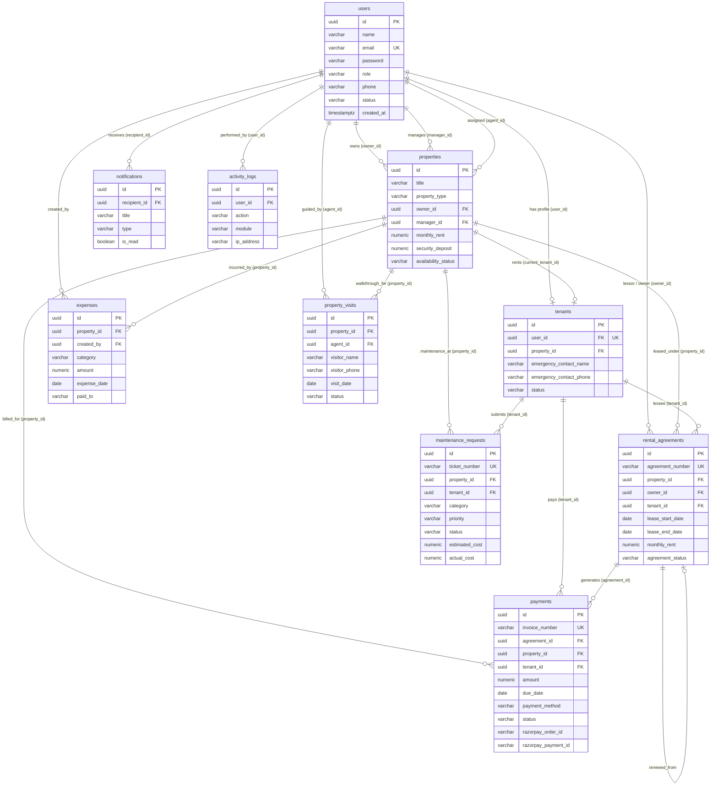

# PropertyHub &mdash; PostgreSQL Database Schema & Relational Design

## 1. System Entity-Relationship (ER) Diagram



---

## 2. Table Specifications & Relationships

### 1. `users` Table
- **Primary Key**: `id` (UUID v4)
- **Roles**: `ADMIN`, `PROPERTY_OWNER`, `PROPERTY_MANAGER`, `AGENT`, `TENANT`
- **Unique Indexes**: `email`
- **Relationships**:
  - `1 -> N` with `properties` (as Owner)
  - `1 -> N` with `properties` (as Manager)
  - `1 -> 1` with `tenants` (User to Tenant profile)
  - `1 -> N` with `rental_agreements`
  - `1 -> N` with `expenses`
  - `1 -> N` with `notifications`

### 2. `properties` Table
- **Primary Key**: `id` (UUID v4)
- **Foreign Keys**:
  - `owner_id -> users(id) ON DELETE CASCADE`
  - `manager_id -> users(id) ON DELETE SET NULL`
  - `assigned_agent_id -> users(id) ON DELETE SET NULL`
  - `current_tenant_id -> tenants(id) ON DELETE SET NULL`
- **Data Types**: `monthly_rent` (NUMERIC 12,2), `amenities` (TEXT[]), `images` (TEXT[])

### 3. `tenants` Table
- **Primary Key**: `id` (UUID v4)
- **Foreign Keys**:
  - `user_id -> users(id) ON DELETE CASCADE` (Unique: 1-to-1)
  - `property_id -> properties(id) ON DELETE SET NULL`
- **Attributes**: Identity verification (Aadhaar / PAN), emergency contacts, employment details.

### 4. `rental_agreements` Table
- **Primary Key**: `id` (UUID v4)
- **Unique Constraints**: `agreement_number`
- **Foreign Keys**:
  - `property_id -> properties(id) ON DELETE CASCADE`
  - `owner_id -> users(id) ON DELETE CASCADE`
  - `tenant_id -> tenants(id) ON DELETE CASCADE`
  - `renewed_from_id -> rental_agreements(id) ON DELETE SET NULL` (Self-referencing for lease extensions)

### 5. `payments` Table (Razorpay & Invoicing)
- **Primary Key**: `id` (UUID v4)
- **Unique Constraints**: `invoice_number`
- **Foreign Keys**:
  - `agreement_id -> rental_agreements(id) ON DELETE CASCADE`
  - `property_id -> properties(id) ON DELETE CASCADE`
  - `tenant_id -> tenants(id) ON DELETE CASCADE`
- **Payment Gateways**: Razorpay (`razorpay_order_id`, `razorpay_payment_id`, `razorpay_signature`), UPI, Net Banking, Cards.

### 6. `maintenance_requests` Table
- **Primary Key**: `id` (UUID v4)
- **Unique Constraints**: `ticket_number`
- **Foreign Keys**:
  - `property_id -> properties(id) ON DELETE CASCADE`
  - `tenant_id -> tenants(id) ON DELETE CASCADE`
- **Attributes**: Category (Plumbing, Electrical, HVAC, etc.), priority, assigned technician, estimated & actual costs.

### 7. `expenses` Table
- **Primary Key**: `id` (UUID v4)
- **Foreign Keys**:
  - `property_id -> properties(id) ON DELETE CASCADE`
  - `created_by -> users(id) ON DELETE CASCADE`
- **Attributes**: Maintenance, utilities, property taxes, insurance, management fees.

### 8. `property_visits` Table
- **Primary Key**: `id` (UUID v4)
- **Foreign Keys**:
  - `property_id -> properties(id) ON DELETE CASCADE`
  - `agent_id -> users(id) ON DELETE SET NULL`
- **Attributes**: Prospective tenant walkthroughs, scheduling, and agent tour feedback.

### 9. `notifications` Table
- **Primary Key**: `id` (UUID v4)
- **Foreign Keys**:
  - `recipient_id -> users(id) ON DELETE CASCADE`
- **Attributes**: In-app notifications with JSON metadata for contextual redirection.

### 10. `activity_logs` Table
- **Primary Key**: `id` (UUID v4)
- **Foreign Keys**:
  - `user_id -> users(id) ON DELETE SET NULL`
- **Attributes**: Immutable audit logs capturing user actions, IP addresses, and mutated modules.

---

## 3. How to Execute

### Option A: Via Command Line (psql)
```bash
psql -U postgres -h localhost -d propertyhub -f server/src/database/schema.sql
psql -U postgres -h localhost -d propertyhub -f server/src/database/seed.sql
```

### Option B: Via Cloud SQL Editor (Neon / Supabase / Render / ElephantSQL)
1. Open the SQL Editor in your cloud dashboard.
2. Copy and paste the contents of [`server/src/database/schema.sql`](file:///c:/Users/dorab/OneDrive/Desktop/Mtech_KLU/fullstack%20web%20engineering/property%20management/server/src/database/schema.sql) and click **Run**.
3. Copy and paste [`server/src/database/seed.sql`](file:///c:/Users/dorab/OneDrive/Desktop/Mtech_KLU/fullstack%20web%20engineering/property%20management/server/src/database/seed.sql) and click **Run**.
